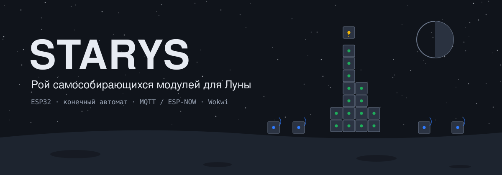
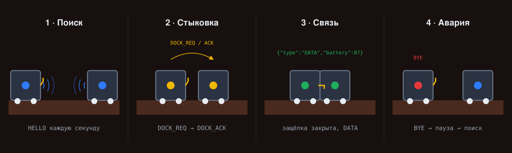
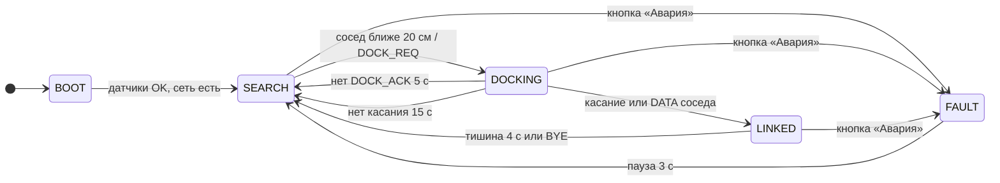
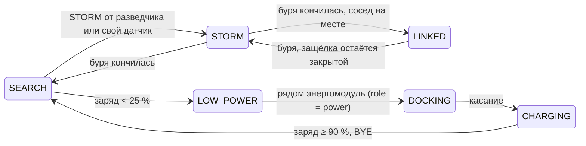
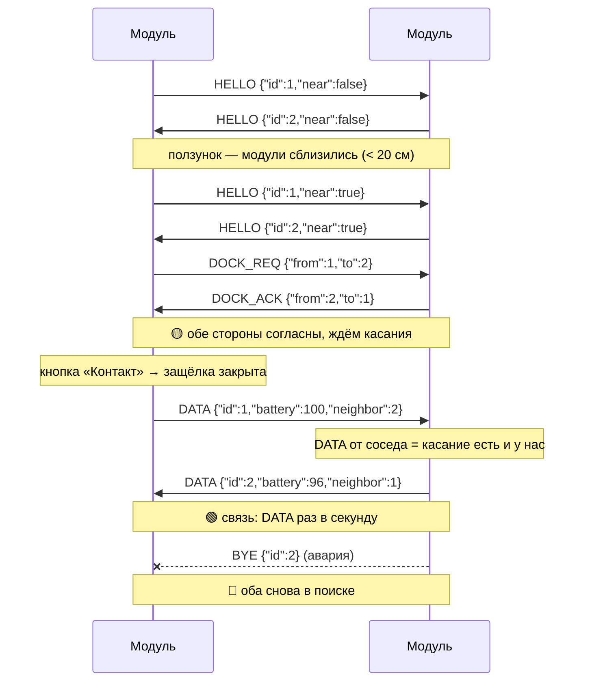
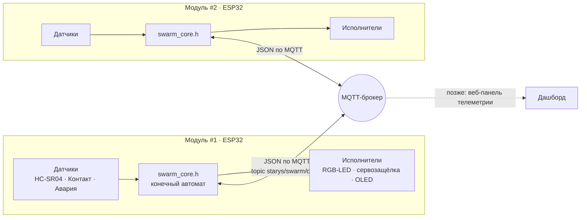
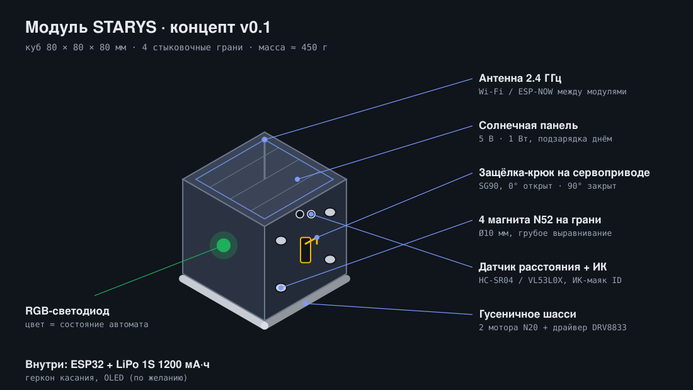
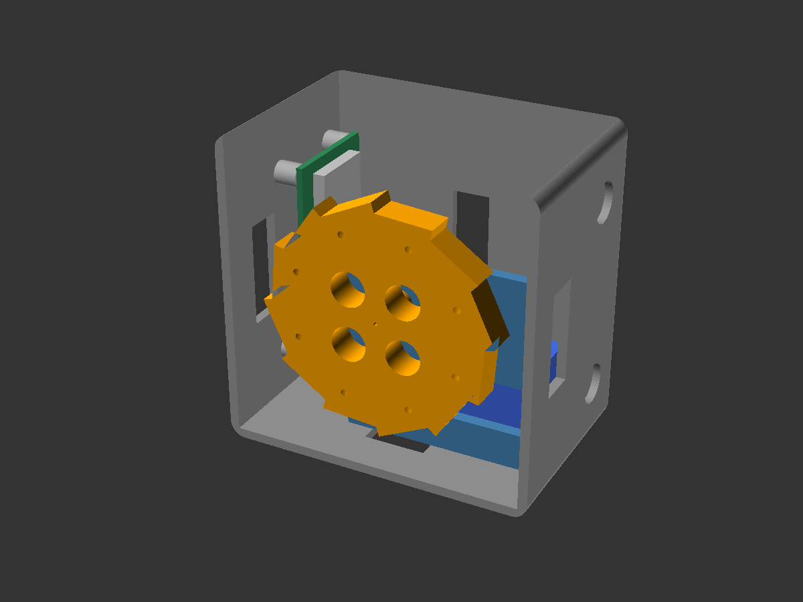
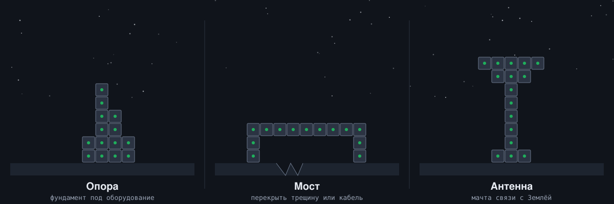

<p align="center">
  
</p>

<p align="center">
  <b>Рой простых модулей, которые сами находят друг друга, стыкуются<br>и собираются в опору, мост или антенну. Готовят Марс к прилёту людей.</b>
</p>

<p align="center">
  <a href="https://manskill586-tech.github.io/STARYS/">▶ Живое демо в браузере</a> ·
  <a href="docs/concept.md">Идея</a> ·
  <a href="docs/architecture.md">Как устроен мозг</a> ·
  <a href="docs/protocol.md">Протокол</a> ·
  <a href="docs/hardware.md">Железо</a> ·
  <a href="docs/ideas.md">Идеи развития</a> ·
  <a href="docs/environments.md">Земля и другие миры</a> ·
  <a href="docs/roadmap.md">План</a> ·
  <a href="docs/team.md">Команда</a>
</p>

---

## Коротко

Чтобы на Марсе появилась база, там сначала нужно построить инфраструктуру: площадки, опоры, мачты антенн, защитные стены. Людей на Марсе ещё нет, а связь с Землёй идёт с задержкой от 3 до 22 минут, так что управлять стройкой с пульта невозможно. **STARYS** предлагает другой путь: отправить рой одинаковых простых модулей, которые соберутся в нужную конструкцию сами и сами справятся со сбоями. Похожую идею развивает NASA в проекте ARMADAS (Automated Reconfigurable Mission Adaptive Digital Assembly Systems): роботы собирают большие конструкции из одинаковых решётчатых блоков.

Мы делаем **первый кирпичик** такой системы: «мозг» одного модуля. Это прошивка для ESP32, которая:

- **ищет** соседа и рассылает `HELLO`;
- **договаривается** о стыковке (`DOCK_REQ` → `DOCK_ACK`);
- **защёлкивается** по сигналу датчика касания и обменивается телеметрией (`DATA`);
- **восстанавливается** после аварии или обрыва связи и стыкуется заново.

Всё работает в симуляторе [Wokwi](https://wokwi.com), так что железо на старте не нужно. Прошивка без изменений переносится на настоящие платы ESP32.

| Что уже есть в репозитории | Где |
|---|---|
| Прошивка модуля: автомат на 5 состояний, MQTT, Serial-режим | [`firmware/src`](firmware/src) |
| Тесты логики на компьютере: 97 проверок, сценарий демо, буря, зарядка, расчёт маховика | [`firmware/test`](firmware/test) |
| Схемы Wokwi для двух модулей | [`firmware/wokwi`](firmware/wokwi) |
| Интерактивная веб-демка: два модуля, рой из 18 модулей, энергомодуль и пылевая буря | [`docs/index.html`](docs/index.html) |
| 3D-прототипы корпуса и крюка защёлки (OpenSCAD) | [`hardware`](hardware) |
| Концепт, протокол, железо, план, роли команды | [`docs`](docs) |
| Идеи развития с расчётами для Марса: EPM-магниты, прыжки, анализаторы, роли, выживание в бурю | [`docs/ideas.md`](docs/ideas.md) |
| Как перестроить модули для Земли, Луны, Венеры, Титана, астероидов | [`docs/environments.md`](docs/environments.md) |
| План на команду из трёх человек и промты для ИИ-наставников новичков | [`docs/team.md`](docs/team.md), [`docs/prompts`](docs/prompts) |

## Как это выглядит

<p align="center">
  
</p>

Цвет светодиода всегда показывает, что модуль сейчас делает:

| Состояние | Светодиод | Что делает модуль |
|---|---|---|
| Запуск `BOOT` | ⚪ белый | Проверяет датчики и подключается к сети |
| Поиск `SEARCH` | 🔵 синий, мигает | Рассылает `HELLO` и ждёт соседа поблизости |
| Стыковка `DOCKING` | 🟡 жёлтый | Обменивается `DOCK_REQ` / `DOCK_ACK`, ждёт касания |
| Связь `LINKED` | 🟢 зелёный | Защёлка закрыта, раз в секунду шлёт `DATA` |
| Ошибка `FAULT` | 🔴 красный | Открывает защёлку, шлёт `BYE`, через 3 с уходит в поиск |
| Буря `STORM` | 🟣 фиолетовый, редкая вспышка | Пылевая буря: держится за соседа, молчит в эфире, ждёт конца бури |
| Мало заряда `LOW_POWER` | 🟠 оранжевый | Заряд ниже 25 %: бросает работу и ищет энергомодуль |
| Зарядка `CHARGING` | 🟠 оранжевый, мигает | Пристыкован к энергомодулю, заряжается до 90 % и возвращается к работе |

## Мозг модуля: конечный автомат

В каждый момент модуль находится ровно в одном из восьми состояний: пять основных и три марсианских (буря, мало заряда, зарядка). Переход случается по событию: показание датчика, нажатие кнопки, сообщение от соседа или истёкший тайм-аут. В коде нет ни одного `delay()`, только сравнение с `millis()`.



Марсианские состояния: из любого рабочего состояния буря переводит модуль в `STORM`, а низкий заряд отправляет к энергомодулю.



## Рукопожатие двух модулей



Почему в `HELLO` есть флаг `near`: датчик расстояния видит *что-то* впереди, но не знает *кого*. Модуль стыкуется только с тем, кто тоже сообщил «я вплотную». Без этого в рое из трёх модулей модуль мог бы позвать на стыковку дальнего соседа. Эту ошибку нашёл тест [`testIgnoresForeignTraffic`](firmware/test/test_core.cpp). Подробнее: [docs/protocol.md](docs/protocol.md).

## Архитектура



Логика живёт в одном файле [`swarm_core.h`](firmware/src/swarm_core.h), который не зависит от Arduino. Поэтому один и тот же код:

1. работает на ESP32 (через [`main.cpp`](firmware/src/main.cpp): датчики, MQTT, светодиод, сервопривод);
2. проверяется тестами на обычном компьютере за доли секунды;
3. перенесён один в один в веб-демо, где его можно потрогать без установки.

## Устройство модуля (концепт v0.2)

<p align="center">
  
</p>

В симуляторе модуль — это ESP32 и стандартные детали Wokwi. Настоящий модуль — куб 80 мм с четырьмя одинаковыми стыковочными гранями: магниты для выравнивания, крюк на сервоприводе для фиксации, датчик расстояния и ИК-маяк для опознания соседа.

Внутри — **маховик с храповым тормозом**: мотор раскручивает его, тормоз резко останавливает, и куб перекатывается через ребро на соседа или подпрыгивает через камень. Корпус при этом полностью закрыт от пыли. Нужные обороты модуль считает сам по измеренной гравитации: на Марсе ≈ 5 500 об/мин, на Земле ≈ 8 900 ([`flywheel.h`](firmware/src/flywheel.h)).

<p align="center"></p>

Список деталей и прикидка цены на один модуль (около 3 300 ₽) — в [docs/hardware.md](docs/hardware.md). 3D-модели корпуса, маховика и защёлки — в [`hardware/`](hardware); все собираются в OpenSCAD и проверены на пересечения.

## Куда это растёт

<p align="center">
  
</p>

- **3 и больше модулей** и планировщик (позже — ИИ), который решает, кто куда встаёт, чтобы собрать заданную фигуру. Прототип планировщика уже работает во [второй части веб-демо](https://manskill586-tech.github.io/STARYS/#swarm).
- **Перенос на настоящие ESP32** с магнитной стыковкой и связью ESP-NOW или по ИК. Прошивка остаётся той же, меняется только транспорт.
- **Роли модулей:** строители, энергомодули, разведчики-метеостанции, связисты, якоря. Роль уже передаётся в протоколе.
- **Выживание на Марсе:** режим пылевой бури, возврат на зарядку, очистка граней от магнитной пыли. Opportunity погиб в буре, InSight — от пыли на панелях; рой должен пережить и то и другое.
- **Цель:** инфраструктура марсианской базы до прилёта людей — посадочные площадки, опоры, мачты антенн, каркасы солнечных ферм, цепочки связи в лавовые трубки.

Все идеи с расчётами: [docs/ideas.md](docs/ideas.md).

### И не только Марс

Мозг и протокол одинаковые везде, меняется только «тело». Тот же рой полезен на Земле: поиск людей под завалами, временные мосты после наводнений, осмотр труб, станции в Антарктиде. Как перестроить модуль под Землю, Луну, Венеру, Титан или астероид и почему на комете слишком сильный прыжок унесёт модуль в космос — в [docs/environments.md](docs/environments.md).

## Быстрый старт

**Посмотреть, ничего не устанавливая.** Откройте [живое демо](https://manskill586-tech.github.io/STARYS/) (работает, когда включён GitHub Pages, см. ниже) или скачайте [`docs/index.html`](docs/index.html) и откройте файл в браузере.

**Как включить демо-страницу на GitHub Pages:**

1. Репозиторий должен быть публичным: *Settings → General → Danger Zone → Change repository visibility → Public*. На бесплатном тарифе GitHub Pages для приватных репозиториев не работает.
2. *Settings → Pages → Build and deployment → Source: Deploy from a branch*, ветка `ccr-be9fdb4b-7vwzxu`, папка `/docs`, *Save*.
3. Через 1–2 минуты страница откроется по адресу `https://manskill586-tech.github.io/STARYS/`.

**Запустить тесты логики** (нужен только компилятор C++):

```bash
cd firmware/test
make          # 97 проверок
make trace    # то же, но с журналом переходов и сообщений
```

**Запустить модуль в Wokwi на сайте:**

1. Создайте на [wokwi.com](https://wokwi.com) новый проект *ESP32*.
2. Замените `diagram.json` содержимым [`firmware/wokwi/module1/diagram.json`](firmware/wokwi/module1/diagram.json).
3. Вставьте [`firmware/src/main.cpp`](firmware/src/main.cpp) в `sketch.ino` и добавьте вкладку `swarm_core.h` с содержимым [`firmware/src/swarm_core.h`](firmware/src/swarm_core.h).
4. Добавьте библиотеки из [`firmware/wokwi/libraries.txt`](firmware/wokwi/libraries.txt).
5. Повторите в другой вкладке для модуля №2, поменяв `#define MODULE_ID 1` на `2`.
6. Запустите обе симуляции и пройдите [сценарий демо](docs/demo.md).

**Собрать прошивку локально** через [PlatformIO](https://platformio.org):

```bash
cd firmware
pio run            # оба модуля
pio run -e module1 # только модуль №1
```

Готовые `.bin` подхватываются расширением Wokwi для VS Code через [`wokwi.toml`](firmware/wokwi/module1/wokwi.toml).

## Демо на защите — 3 минуты

1. Два модуля запущены, оба мигают синим: идёт поиск.
2. Ползунком «приближаем» соседа — светодиоды жёлтые, модули договариваются о стыковке.
3. Нажимаем «Контакт» — защёлка закрывается, свет зелёный, на экране идут данные соседа.
4. Жмём «Авария» — красный, затем модули сами возвращаются в поиск и стыкуются снова.

Полный сценарий и таблица проверок: [docs/demo.md](docs/demo.md).

## Структура репозитория

```
STARYS/
├── README.md              ← вы здесь
├── assets/                рисунки для README
├── docs/
│   ├── index.html         интерактивное демо (GitHub Pages)
│   ├── concept.md         проблема, решение, аналоги
│   ├── ideas.md           идеи развития с расчётами для Марса
│   ├── environments.md    Земля, Луна, Венера, Титан, астероиды
│   ├── architecture.md    автомат, тайминги, устройство кода
│   ├── protocol.md        сообщения и рукопожатие
│   ├── hardware.md        схема Wokwi, распиновка, детали настоящего модуля
│   ├── demo.md            сценарий защиты и таблица тестов
│   ├── roadmap.md         5 недель и что дальше
│   ├── team.md            роли и задачи команды из трёх человек
│   └── prompts/           промты для ИИ-наставников «Железа» и «Софта»
├── firmware/
│   ├── platformio.ini
│   ├── src/
│   │   ├── swarm_core.h   мозг: автомат и протокол, без Arduino
│   │   ├── flywheel.h     расчёт оборотов маховика по измеренному g
│   │   └── main.cpp       тело: датчики, MQTT, LED, сервопривод, OLED
│   ├── test/              тесты логики на компьютере
│   └── wokwi/             схемы: два строителя и энергомодуль
└── hardware/
    ├── module_body.scad   корпус модуля 80 мм
    ├── flywheel.scad      маховик, храповый тормоз, кронштейн
    ├── latch_hook.scad    крюк защёлки на SG90
    └── assembly.scad      сборка в разрезе
```

## Лицензия

[MIT](LICENSE): код и модели можно свободно использовать и дорабатывать.
