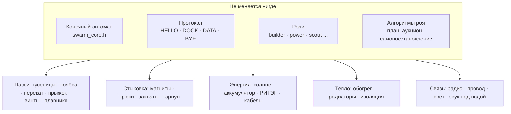

# STARYS в разных мирах: Земля, планеты, луны, астероиды

← [на главную](../README.md) · [идеи развития](ideas.md)

Главная мысль: **мозг и протокол одинаковые везде, меняется только «тело».** Автомат из [`swarm_core.h`](../firmware/src/swarm_core.h) не знает, на какой он планете. Под каждые условия меняются шасси, способ стыковки, источник энергии, защита от тепла или холода и канал связи.



## 1. Сравнение миров

| Мир | g, м/с² | Атмосфера | Температура | Главная трудность |
|---|---|---|---|---|
| Земля | 9,81 | 1 бар | −50…+50 °C | вода, грязь, люди рядом |
| Луна | 1,62 | вакуум | −170…+120 °C | двухнедельная ночь, абразивная пыль |
| **Марс** | 3,71 | 0,006 бар, CO₂ | −125…+20 °C | пылевые бури, магнитная пыль |
| Венера (поверхность) | 8,87 | 92 бар, CO₂, облака серной кислоты | ≈ +465 °C | обычная электроника плавится за минуты |
| Титан (спутник Сатурна) | 1,35 | 1,5 бар, азот | ≈ −180 °C | мало солнца, метановые озёра |
| Европа (спутник Юпитера) | 1,31 | вакуум | ≈ −160 °C | сильнейшая радиация, лёд толщиной в километры |
| Энцелад (спутник Сатурна) | 0,11 | вакуум | ≈ −200 °C | гейзеры, слабая гравитация |
| Церера (карликовая планета) | 0,28 | вакуум | ≈ −100 °C | слабая гравитация, мало солнца |
| Фобос (спутник Марса) | ≈ 0,006 | вакуум | −110…−4 °C | почти невесомость |
| Комета 67P | ≈ 0,0002 | вакуум, выбросы газа | −270…−70 °C | толчок может унести модуль в космос |

### Один и тот же прыжок в разных мирах

Пружина на 0,5 Дж разгоняет модуль массой 0,45 кг до **v ≈ 1,5 м/с** — везде одинаково. А высота прыжка h = v² / 2g и время полёта t = 2v / g зависят от гравитации:

| Мир | Высота прыжка | Время в полёте | Вывод |
|---|---|---|---|
| Земля | 11 см | 0,3 с | прыжок — только через небольшие препятствия |
| Марс | 30 см | 0,8 с | удобный способ перебраться через камень |
| Луна | 69 см | 1,8 с | приземление нужно гасить |
| Титан | 82 см | 2,2 с | плотный воздух тормозит: можно планировать |
| Церера | 4 м | 11 с | прыгать слабо и только с ориентацией |
| Энцелад | 10 м | 27 с | нужна точная сила толчка |
| Фобос | ≈ 190 м | ≈ 9 мин | прыжок = полёт; без якоря модуль потеряется |
| Комета 67P | — | — | 1,5 м/с больше скорости убегания (~1 м/с): **модуль улетит навсегда** |

Отсюда правило: **сила любого толчка рассчитывается от измеренного g.** Каждый модуль меряет g акселерометром при запуске, а в слабой гравитации сначала закрепляется, потом действует.

## 2. Конфигуратор: что поставить в модуль для каждого мира

| Мир | Шасси | Стыковка | Энергия | Тепло | Связь |
|---|---|---|---|---|---|
| **Земля** | гусеницы, колёса | механический захват + магниты; корпус IP67 | аккумулятор, солнце, зарядная станция | пассивно | Wi-Fi, LoRa, GPS доступен |
| **Луна** | гусеницы, перекат по конструкции | механический крюк; осторожно с голым металлом (см. ниже) | солнце + большой аккумулятор на ночь | обогрев ночью, радиаторы днём | ESP-NOW, ретранслятор на Землю |
| **Марс** | гусеницы, перекат, прыжок | EPM + крюк + очистка граней от магнитной пыли | солнце + энергомодули | аэрогель, подогрев батареи | ESP-NOW, UWB, связь через орбитальный спутник |
| **Венера** | рой в облаках на высоте 50–60 км (там примерно от 0 до +75 °C и 0,2–1 бар) или очень простые модули на поверхности | захват, подъёмный баллон | солнце над облаками | на поверхности — электроника на карбиде кремния (SiC), как в разработке NASA LLISSE | радио через аэростат |
| **Титан** | полёт: плотный воздух и слабая гравитация делают винтокрыл выгодным (миссия NASA Dragonfly) | захват, магниты | РИТЭГ — солнца очень мало | мощная изоляция, тепло от РИТЭГ | через материнский аппарат |
| **Европа, Энцелад** | под ледяной коркой: модули-подлодки; на поверхности — якорь и перекат | механический замок в воде | РИТЭГ, аккумуляторы | тепло РИТЭГ плавит лёд | под водой — звук и свет, через лёд — кабель с ретрансляторами |
| **Церера, Фобос, кометы** | прыжок или маховик, перекат | сначала якорь или гарпун, потом действие | солнце, аккумулятор | как на Луне | ретранслятор на орбите |

### Особые случаи

- **Холодная сварка в вакууме.** На Луне и астероидах чистые металлические поверхности при плотном контакте могут «свариться» друг с другом. Поэтому грани и крюки делают с покрытием или из разных материалов.
- **Венера.** Вместо одного дорогого посадочного аппарата, который живёт на поверхности около часа (советские «Венеры» проработали до ~2 часов), — рой дешёвых простых модулей. Каждый успевает сделать замер, и вместе они покрывают большую площадь.
- **Подлёдные океаны.** Цепочка модулей-ретрансляторов во льду передаёт данные от подлодки к поверхности. Это та же идея, что [цепочка в лавовую трубку на Марсе](ideas.md#8-что-строить-на-марсе).
- **Слабая гравитация.** Перекат по конструкции и EPM становятся основным способом движения: в почти невесомости модуль держится за соседей, как альпинист за скалу.

## 3. STARYS на Земле

Рой самособирающихся модулей нужен и на Земле: везде, где человеку опасно или неудобно работать, а форма нужной конструкции заранее неизвестна.

| Применение | Что делает рой | Какие роли | Что изменить в модуле |
|---|---|---|---|
| **Поиск людей под завалами** | модули пролезают в щели, выстраивают цепочку связи вглубь завала, ищут людей | разведчик (тепловизор, микрофон, датчик CO₂), связист | маленький размер, прочный корпус, гусеницы |
| **Временный мост или переход** | после наводнения или землетрясения собирается настил через ручей или пролом | строитель, якорь, пассивные блоки | механический замок на большую нагрузку, водонепроницаемость |
| **Противопаводковая стена** | модули встают в линию и сцепляются, удерживая мешки или щиты | строитель, якорь | IP68, анкеры в грунт |
| **Осмотр труб и тоннелей** | цепочка модулей проходит по трубе, разведчик ищет утечки и трещины, связисты передают данные наружу | разведчик, связист | колёса под трубу, без радио — по проводу через грани |
| **Атомные станции и химзаводы** | осмотр и мелкий ремонт в зонах с радиацией | разведчик, строитель | защита электроники от радиации — те же меры, что для Марса |
| **Мониторинг вулканов и ледников** | сеть модулей-метеостанций сама расставляется и перестраивается при обвале | разведчик, связист, энергомодуль | термозащита, LoRa для дальней связи |
| **Антарктические станции** | сборка вышек, антенн, укрытий зимой без выхода людей на мороз | все роли | обогрев аккумуляторов, как на Марсе |
| **Сельское хозяйство** | модули-датчики сами расставляются по полю, меряют влажность, перестраиваются под культуру | разведчик, энергомодуль | влагозащита, солнечные панели |
| **Учебный конструктор** | школьники собирают рой и программируют поведение | любые | дешёвый корпус, Wi-Fi, наш протокол как готовая основа |

На Земле многое проще: есть GPS, сильная гравитация держит конструкцию, есть зарядные станции. Сложнее другое: вода, грязь и **люди рядом**. Нужны ограничение силы приводов, кнопка аварийной остановки (в нашем автомате это готовое состояние `FAULT`) и понятная индикация светодиодом, которая у нас уже есть.

## 4. Как это поддержать в коде

Почти всё уже готово, потому что мозг отделён от тела.

| Что | Как | Статус |
|---|---|---|
| Роль модуля | `enum class Role` и поле `role` в `HELLO` | ✅ сделано |
| Профиль мира | структура `Config` уже хранит тайминги и дистанции; добавить g, силу толчка, пороги ветра и температуры | следующий шаг |
| Калибровка по g | при запуске модуль меряет g акселерометром и считает силу толчка | следующий шаг |
| Транспорт | `main.cpp` меняет MQTT на ESP-NOW, LoRa, провод или звук; `swarm_core.h` не меняется | архитектура готова |
| Новые состояния | `STORM`, `LOW_POWER`, `CHARGING`, `NIGHT` из [идей](ideas.md#6-выживание-на-марсе) — для любого мира с бурями и ночами | в планах |

Пример будущего профиля:

```cpp
// Профиль мира: всё, что отличается между Землёй, Марсом и Титаном.
struct WorldProfile {
  const char* name;
  float gravity;        // м/с², уточняется акселерометром при запуске
  float maxWindMs;      // выше — запрет прыжков и точных стыковок
  float minBatteryTempC;// ниже — сначала греть, потом заряжать
  bool anchorFirst;     // слабая гравитация: сначала закрепиться
};

const WorldProfile EARTH = {"Earth", 9.81f, 15.0f, 0.0f, false};
const WorldProfile MARS  = {"Mars",  3.71f, 20.0f, 0.0f, false};
const WorldProfile PHOBOS= {"Phobos",0.0057f, 0.0f, 0.0f, true};
```
