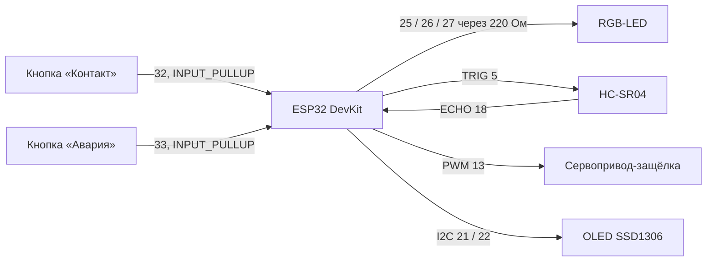

# Железо

← [на главную](../README.md)

## 1. Модуль в симуляторе Wokwi

Каждый модуль — отдельный проект Wokwi с ESP32. Деталей, которых в симуляторе нет (магнитный замок, ИК-связь), заменяем похожими.

| Компонент в Wokwi | Что он изображает в реальном модуле | Пины ESP32 |
|---|---|---|
| ESP32 DevKit C v4 | мозг модуля | — |
| RGB-светодиод + 3 резистора 220 Ом | индикатор состояния | R 25 · G 26 · B 27 |
| Ультразвуковой датчик HC-SR04 | датчик расстояния до соседа (дистанция задаётся ползунком) | TRIG 5 · ECHO 18 |
| Кнопка «Контакт» (зелёная, клавиша `C`) | датчик касания при стыковке, в железе — геркон или концевик | 32 → GND |
| Кнопка «Авария» (красная, клавиша `F`) | имитация сбоя: обрыв, удар | 33 → GND |
| Сервопривод | механическая защёлка | PWM 13 |
| OLED SSD1306 128×64 | вывод состояния и данных соседа | SDA 21 · SCL 22 |

Готовая схема: [`firmware/wokwi/module1/diagram.json`](../firmware/wokwi/module1/diagram.json).

## 2. Настоящий модуль (концепт v0.1)

Куб с ребром 80 мм, напечатанный на 3D-принтере. Четыре боковые грани одинаковые и все годятся для стыковки, поэтому модулю не важно, каким боком он подъехал.

### Как работает стыковка

1. **Подъезд.** Модуль едет на гусеницах к соседу и по датчику расстояния останавливается в ~1 см.
2. **Выравнивание.** Четыре магнита на гранях притягивают модули и сами доводят грани до совпадения в пределах пары миллиметров.
3. **Касание.** Геркон на грани замыкается от магнита соседа — это и есть сигнал «Контакт».
4. **Фиксация.** Сервопривод поворачивает крюк на 90°, крюк проходит в окно соседа и цепляется за его штифт. Теперь модули держатся механически, а не только на магнитах.
5. **Расцепление.** Крюк возвращается в 0°. Магниты слабее, чем гусеницы, поэтому модуль может отъехать.

В прототипе v0.1 сервопривод с крюком стоит на одной грани, а на трёх остальных — пассивные штифты. Этого достаточно, чтобы собрать цепочку и показать принцип. В v1 каждая грань получает свой крюк.

### 3D-модели

| Файл | Что это |
|---|---|
| [`hardware/module_body.scad`](../hardware/module_body.scad) | корпус и крышка: гнёзда магнитов, окна защёлки, отверстия HC-SR04, стойки под ESP32, посадка солнечной панели |
| [`hardware/latch_hook.scad`](../hardware/latch_hook.scad) | крюк защёлки на качалку SG90 с фаской на зубе |

Откройте в [OpenSCAD](https://openscad.org): F5 — просмотр, F6 — рендер, *File → Export → STL*. Все размеры — параметры в начале файла.

### Список деталей на один модуль

Цены — ориентир по розничным интернет-магазинам на 2026 год, могут заметно отличаться.

| Деталь | Кол-во | ≈ ₽ |
|---|---:|---:|
| ESP32 DevKit (ESP32-WROOM-32) | 1 | 450 |
| Сервопривод SG90 | 1 | 150 |
| Датчик расстояния HC-SR04 (или VL53L0X, точнее и меньше) | 1 | 120 |
| ИК-приёмник + ИК-светодиод (опознание соседа) | 1 пара | 60 |
| Неодимовые магниты N52 Ø10×3 мм | 16 | 300 |
| Геркон | 1 | 30 |
| RGB-светодиод 5 мм + резисторы | 1 | 20 |
| Аккумулятор LiPo 1S 1200 мА·ч | 1 | 350 |
| Плата заряда TP4056 с защитой | 1 | 60 |
| Солнечная панель 5 В 1 Вт 60×60 мм | 1 | 200 |
| Мотор-редуктор N20 | 2 | 500 |
| Драйвер моторов DRV8833 | 1 | 120 |
| OLED SSD1306 0,96" (по желанию) | 1 | 250 |
| PLA/PETG ~120 г, винты M2/M3, провода | — | 200 |
| **Итого** | | **≈ 2 800** |

Два модуля для демо — около 5 600 ₽. Без OLED и солнечной панели — около 4 700 ₽.

### Питание

| Потребитель | Ток |
|---|---|
| ESP32 с Wi-Fi / ESP-NOW | 80–160 мА |
| Сервопривод в движении | до 250 мА, кратко |
| Моторы N20 в движении | 2 × 100 мА |
| Светодиод, датчики | ~30 мА |

При 1200 мА·ч модуль проработает ~4–6 часов в активном режиме. Днём его подзаряжает панель, ночью он спит (`esp_deep_sleep`) и просыпается в поиске.
