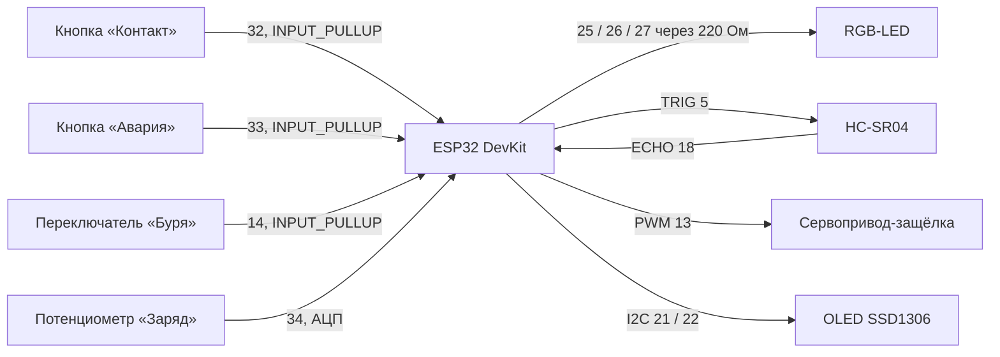

# Железо

← [на главную](../README.md)

## 1. Модуль в симуляторе Wokwi

Каждый модуль — отдельный проект Wokwi с ESP32. Деталей, которых в симуляторе нет (магнитный замок, ИК-связь, датчик пыли), заменяем похожими.

| Компонент в Wokwi | Что он изображает в реальном модуле | Пины ESP32 |
|---|---|---|
| ESP32 DevKit C v4 | мозг модуля | — |
| RGB-светодиод + 3 резистора 220 Ом | индикатор состояния (ШИМ: есть фиолетовый и оранжевый) | R 25 · G 26 · B 27 |
| Ультразвуковой датчик HC-SR04 | датчик расстояния до соседа (дистанция задаётся ползунком) | TRIG 5 · ECHO 18 |
| Кнопка «Контакт» (зелёная, клавиша `C`) | датчик касания при стыковке, в железе — геркон | 32 → GND |
| Кнопка «Авария» (красная, клавиша `F`) | имитация сбоя: обрыв, удар | 33 → GND |
| Переключатель «Буря» | датчик пыли и ветра; у разведчика он поднимает тревогу на весь рой | 14 → GND |
| Потенциометр «Заряд» | уровень батареи: повернули влево — модуль едет заряжаться | 34 (АЦП) |
| Сервопривод | механическая защёлка | PWM 13 |
| OLED SSD1306 128×64 | роль, состояние, заряд, данные соседа | SDA 21 · SCL 22 |

Готовые схемы: [`module1`](../firmware/wokwi/module1/diagram.json), [`module2`](../firmware/wokwi/module2/diagram.json), [`module3_power`](../firmware/wokwi/module3_power/diagram.json) (энергомодуль). Роль задаётся при сборке: `pio run -e power` или `#define MODULE_ROLE starys::Role::Power` в скетче Wokwi.

## 2. Настоящий модуль (концепт v0.2)

Куб с ребром 80 мм, напечатанный на 3D-принтере. Четыре боковые грани одинаковые и все годятся для стыковки, поэтому модулю не важно, каким боком он подъехал. Внутри по центру — **маховик с храповым тормозом**.

*Сборка в разрезе, рендер из [`hardware/assembly.scad`](../hardware/assembly.scad): оранжевый — маховик, синий — кронштейн и сервопривод тормоза, зелёный — плата ESP32 на боковой стенке.*

### Как работает стыковка

1. **Подъезд.** Модуль едет на гусеницах к соседу и по датчику расстояния останавливается в ~1 см.
2. **Выравнивание.** Четыре магнита на гранях притягивают модули и сами доводят грани до совпадения в пределах пары миллиметров.
3. **Касание.** Геркон на грани замыкается от магнита соседа — это и есть сигнал «Контакт».
4. **Фиксация.** Сервопривод поворачивает крюк на 90°, крюк проходит в окно соседа и цепляется за его штифт. Теперь модули держатся механически, а не только на магнитах.
5. **Расцепление.** Крюк возвращается в 0°. Магниты слабее, чем гусеницы, поэтому модуль может отъехать.

В прототипе сервопривод с крюком стоит на одной грани, а на трёх остальных — пассивные штифты. Этого достаточно, чтобы собрать цепочку и показать принцип. В v1 каждая грань получает свой крюк, а неодимовые магниты заменяются электропостоянными (EPM), см. [идеи](ideas.md#3-магниты-на-гранях).

### Маховик вместо восьми соленоидов

По грунту модуль едет на гусеницах. Чтобы **перекатиться через ребро** на соседа или подпрыгнуть через камень, внутри стоит маховик:

1. коллекторный мотор 8520 (от микродрона) раскручивает маховик;
2. сервопривод опускает собачку на зубья обода;
3. маховик останавливается за доли секунды, и его момент импульса переходит в поворот всего куба вокруг нижнего ребра.

Так же двигаются кубы MIT M-Blocks. Корпус при этом полностью закрыт: нет штоков и щелей для марсианской пыли.

**Сколько оборотов нужно.** Чтобы куб перевалил через ребро, его центр масс должен подняться на Δh = a·(√2 − 1)/2 ≈ 17 мм. Момент импульса маховика L = I·ω переходит в вращение куба вокруг ребра (I = ⅔·m·a²). Отсюда нужные обороты (маховик ≈ 40 г, Ø60 мм; модуль 450 г):

| | g, м/с² | Без запаса | С запасом 30 % | Энергия раскрутки |
|---|---|---|---|---|
| Земля | 9,81 | ≈ 8 900 об/мин | ≈ 10 100 об/мин | ≈ 10 Дж |
| **Марс** | 3,71 | ≈ 5 500 об/мин | ≈ 6 200 об/мин | ≈ 3,8 Дж |
| Луна | 1,62 | ≈ 3 600 об/мин | ≈ 4 100 об/мин | ≈ 1,7 Дж |

Формула живёт в прошивке, в [`firmware/src/flywheel.h`](../firmware/src/flywheel.h): `rpmForPivot(spec, g)`. Модуль меряет g акселерометром и сам считает обороты, поэтому один и тот же код работает на Земле и на Марсе. Тест `testFlywheel` проверяет эти числа.

**Хватит ли батареи.** 1200 мА·ч — это около 4,4 Вт·ч, или ~16 000 Дж. На Марсе один перекат стоит ~3,8 Дж, то есть батареи хватает на тысячи перекатов (с учётом потерь мотора — на сотни).

**Нагрузка на тормоз.** Если маховик останавливается за ~10 мс, на зуб действует около 60 Н. Для PETG это допустимо; для долгой работы зуб собачки лучше сделать стальным.

| | 8 соленоидов по углам | **Маховик** |
|---|---|---|
| Масса | 160–240 г | ≈ 70 г (маховик, мотор, кронштейн, SG90) |
| Прыжок на Марсе | ≈ 3 см | перекат через ребро, при больших оборотах — подскок |
| Пыль | 8 подвижных штоков наружу | корпус закрыт |
| Ток | импульсы ~1 А на каждый | плавная раскрутка, 0,3–0,5 А |

Следующий шаг (v0.3): поставить маховик на поворотную площадку с сервоприводом, тогда модуль сможет перекатываться в любую из четырёх сторон, а не только вперёд и назад.

### 3D-модели

| Файл | Что это |
|---|---|
| [`hardware/module_body.scad`](../hardware/module_body.scad) | корпус и крышка: гнёзда магнитов Ø10×2, окна защёлки, отверстия HC-SR04, стойки ESP32 на боковой стенке, крепление кронштейна маховика, посадка солнечной панели |
| [`hardware/flywheel.scad`](../hardware/flywheel.scad) | маховик с храповиком и гнёздами под 8 стальных шариков, собачка тормоза, хомут мотора 8520, Г-образный кронштейн |
| [`hardware/latch_hook.scad`](../hardware/latch_hook.scad) | крюк защёлки на качалку SG90 с фаской на зубе |
| [`hardware/assembly.scad`](../hardware/assembly.scad) | сборка в разрезе для проверки компоновки |

Откройте в [OpenSCAD](https://openscad.org): F5 — просмотр, F6 — рендер, *File → Export → STL*. Все размеры — параметры в начале файла. У `flywheel.scad` параметр `part` выбирает деталь: `wheel`, `pawl`, `holder`, `bracket` или `all`.

Все модели собираются в OpenSCAD без ошибок. Компоновка проверена на пересечения: маховик, кронштейн, мотор, сервопривод тормоза, плата ESP32, корпус, крышка, сервопривод защёлки и HC-SR04 попарно не пересекаются. Реальные детали всё равно стоит примерить перед печатью: размеры сервопривода и мотора у разных продавцов немного отличаются.

### Список деталей на один модуль

Цены — ориентир по розничным интернет-магазинам на 2026 год, могут заметно отличаться.

| Деталь | Кол-во | ≈ ₽ |
|---|---:|---:|
| ESP32 DevKit (ESP32-WROOM-32) | 1 | 450 |
| Сервопривод SG90 (защёлка + тормоз маховика) | 2 | 300 |
| Коллекторный мотор 8520 + MOSFET AO3400 + диод | 1 | 150 |
| Стальные шарики Ø8 мм (грузы маховика) | 8 | 60 |
| Акселерометр-гироскоп MPU-6050 (g, наклон, контроль переката) | 1 | 150 |
| Датчик расстояния HC-SR04 (или VL53L0X, точнее и меньше) | 1 | 120 |
| ИК-приёмник + ИК-светодиод (опознание соседа) | 1 пара | 60 |
| Неодимовые магниты N52 Ø10×2 мм | 16 | 250 |
| Геркон | 1 | 30 |
| RGB-светодиод 5 мм + резисторы | 1 | 20 |
| Аккумулятор LiPo 1S 1200 мА·ч | 1 | 350 |
| Плата заряда TP4056 с защитой | 1 | 60 |
| Солнечная панель 5 В 1 Вт 60×60 мм | 1 | 200 |
| Мотор-редуктор N20 (гусеницы) | 2 | 500 |
| Драйвер моторов DRV8833 | 1 | 120 |
| OLED SSD1306 0,96" (по желанию) | 1 | 250 |
| PLA/PETG ~160 г, винты M2/M3, провода | — | 250 |
| **Итого** | | **≈ 3 300** |

Два модуля для демо — около 6 600 ₽. Без OLED и солнечной панели — около 5 700 ₽.

### Питание

| Потребитель | Ток |
|---|---|
| ESP32 с Wi-Fi / ESP-NOW | 80–160 мА |
| Сервоприводы в движении | до 250 мА каждый, кратко |
| Моторы N20 в движении | 2 × 100 мА |
| Мотор маховика при раскрутке | 300–500 мА, несколько секунд |
| Светодиод, датчики | ~30 мА |

При 1200 мА·ч модуль проработает ~4–6 часов в активном режиме. Когда заряд падает ниже 25 %, модуль сам переходит в `LOW_POWER` и едет к энергомодулю (это уже есть в прошивке). Ночью он должен спать (`esp_deep_sleep`), но этот режим пока только в планах.
