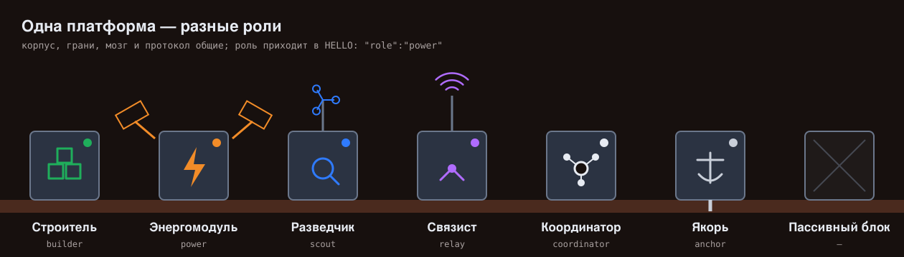
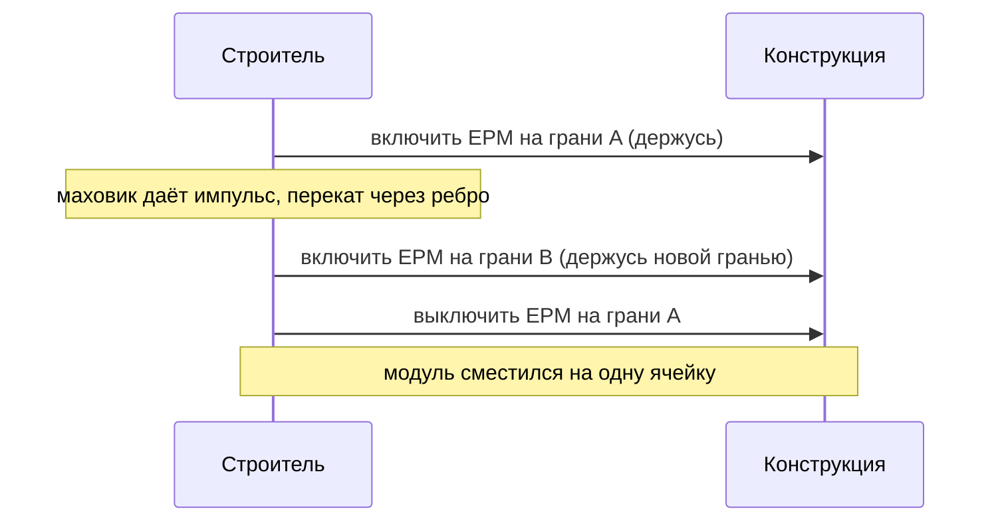
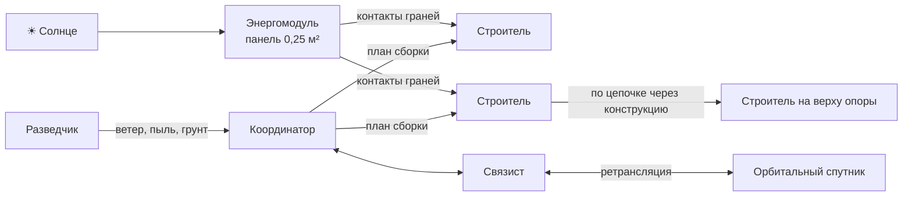
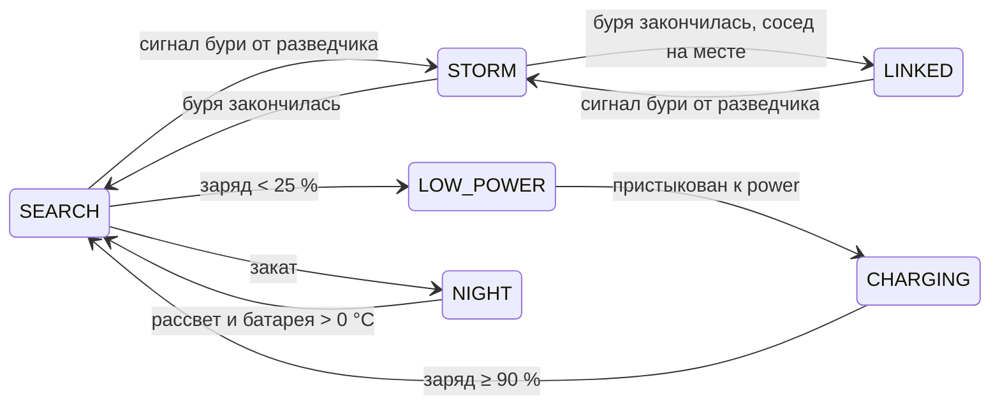

# Идеи развития STARYS

← [на главную](../README.md)

Здесь собраны идеи, как вырасти от «мозга одного модуля» до роя, который строит на Марсе. У каждой идеи есть расчёт или пример из реальных миссий, чтобы её можно было защитить на вопросах жюри.

<p align="center"></p>

## Сводка

| # | Идея | Что даёт | Сложность | Когда |
|---|---|---|---|---|
| 1 | [Роли модулей](#5-разные-модули-в-одном-рое) | рой из «специалистов» на одной платформе | низкая | ✅ в протоколе и прошивке (`role` в `HELLO`) |
| 2 | [Энергомодуль](#5-разные-модули-в-одном-рое) и возврат на зарядку | рой живёт дольше одной батареи | низкая | ✅ в прошивке (`LOW_POWER`, `CHARGING`) и веб-демо |
| 3 | [Режим пылевой бури](#6-выживание-на-марсе) | модули не гибнут, как Opportunity | низкая | ✅ в прошивке (`STORM`, сообщение `STORM`) и веб-демо |
| 4 | [Электропостоянные магниты (EPM)](#3-магниты-на-гранях) | стыковка без постоянного расхода энергии | средняя | после защиты |
| 5 | [Пружинные контакты в гранях](#3-магниты-на-гранях) | питание и проводная связь через стыковку | средняя | после защиты |
| 6 | [Перекат по конструкции](#2-передвижение) | строитель ходит по уже собранному | высокая | v1 |
| 7 | [Маховик вместо соленоидов](#2-передвижение) | перекат через ребро и прыжок, корпус закрыт от пыли | высокая | ✅ в концепте v0.2: 3D-модель, расчёт оборотов в прошивке |
| 8 | [Разведчик-метеостанция](#4-роботы-анализаторы) | меньше ложных срабатываний | средняя | v1 |
| 9 | [UWB-навигация между модулями](#7-связь-и-навигация) | модуль знает, где он, без GPS | средняя | v1 |
| 10 | [Цепочка-ретранслятор в лавовую трубку](#8-что-строить-на-марсе) | связь из пещер, где нет прямой видимости | средняя | v2 |
| 11 | [Цифровой двойник с марсианской физикой](#9-алгоритмы-роя-и-симуляция) | проверка роя из сотен модулей без железа | средняя | v2 |
| 12 | [Защита от сбоев от радиации](#10-надёжность) | модуль не «сходит с ума» от случайной ошибки в памяти | низкая | можно начать сейчас |
| 13 | [Нарисуй фигуру — рой соберёт](#13-новые-идеи) | жюри само задаёт задачу рою | средняя | «Софт», неделя 5 или после защиты |
| 14 | [Задержка связи с Землёй в демо](#13-новые-идеи) | наглядно, зачем рою автономия | низкая | «Софт» |
| 15 | [Ядро в браузере через WebAssembly](#13-новые-идеи) | веб-демо и прошивка — один и тот же код | высокая | лид |
| 16 | [Самопроверка при запуске](#13-новые-идеи) | модуль с битым датчиком не выходит на стройку | низкая | лид + «Железо» |
| 17 | [Подбор таймингов перебором в симуляции](#13-новые-идеи) | автомат настраивается по цифрам, а не на глаз | средняя | «Софт» + лид |
| 18 | [Сравнение планировщиков](#13-новые-идеи) | доказать цифрами, какая стратегия сборки лучше | средняя | «Софт» |
| 19 | [Учебный набор STARYS](#13-новые-идеи) | проект живёт после защиты | низкая | вся команда |

---

## 1. Условия Марса, которые определяют конструкцию

| Условие | Значение | Что из этого следует |
|---|---|---|
| Гравитация | 3,71 м/с² (0,38 земной) | прыжок той же силы в 2,6 раза выше, чем на Земле; конструкции держат больше «этажей» |
| Атмосфера | ~0,6 кПа, в основном CO₂ (меньше 1 % от земной) | сопротивление воздуха есть, но слабое; охлаждение воздухом почти не работает |
| Температура | от −125 °C (полярная зима) до +20 °C (экватор днём), за сутки перепад до ~80 °C | обогрев аккумулятора ночью; литиевые аккумуляторы нельзя заряжать ниже 0 °C |
| Сутки (сол) | 24 ч 39 мин | почти земной ритм: днём работать и заряжаться, ночью спать |
| Солнечный свет | ~43 % от земного над атмосферой, меньше при пыли | панели нужны большие; одна общая выгоднее многих маленьких |
| Пыль | мелкая, абразивная и **магнитная** (оксиды железа) | магниты на гранях будут собирать пыль; панели запыляются |
| Пылевые бури | местные — часто, глобальные — раз в несколько лет, на месяцы | нужен режим «переждать бурю» |
| Радиация | у Марса нет глобального магнитного поля, у поверхности ~0,7 мЗв в сутки | случайные ошибки в памяти электроники |
| Задержка связи с Землёй | от 3 до 22 минут в одну сторону | рой обязан решать всё сам; пульта с Земли нет |
| Навигация | нет GPS, нет общего магнитного поля для компаса | модули определяют положение относительно друг друга |

---

## 2. Передвижение

### 2.1. Восемь соленоидов по углам — почему нет

Маленький соленоид на 5 В отдаёт за удар не больше ~0,05 Дж. Для модуля массой 0,45 кг высота прыжка в идеале h = E / (m·g):

| | g, м/с² | Высота |
|---|---|---|
| Земля | 9,81 | ≈ 1 см |
| **Марс** | 3,71 | **≈ 3 см** |

Плюс 160–240 г массы, импульсы по ~1 А на маленький аккумулятор и восемь открытых щелей для абразивной магнитной пыли. Прыжок на 3 см не стоит такой цены.

### 2.2. Один прыжковый механизм внутри

| Вариант | Энергия | Марс | Земля | Плюсы |
|---|---|---|---|---|
| Пружина, которую медленно взводит мотор | 0,5 Дж | ≈ 30 см | ≈ 11 см | простая механика, большой запас энергии |
| **Маховик с резким торможением** (выбран) | 1,7–10 Дж, см. ниже | перекат при ≈ 5 500 об/мин | перекат при ≈ 8 900 об/мин | корпус полностью закрыт, нет пыли; перекат и подскок одним механизмом |

**Мы выбрали маховик** и поставили его в концепт модуля v0.2: маховик Ø60 мм ≈ 40 г с храповым тормозом на сервоприводе, мотор 8520. Расчёт оборотов для переката живёт в прошивке ([`flywheel.h`](../firmware/src/flywheel.h)), 3D-модель — в [`hardware/flywheel.scad`](../hardware/flywheel.scad), подробности и таблица по планетам — в [hardware.md](hardware.md#маховик-вместо-восьми-соленоидов).

Прецеденты: MIT M-Blocks (кубы перекатываются и запрыгивают друг на друга за счёт маховика), Hedgehog от NASA/JPL и Стэнфорда (прыгающий куб для тел с низкой гравитацией).

**Ветер на Марсе слабый, но для прыжка заметен.** Прыжок на 30 см на Марсе: скорость отрыва v = √(2gh) ≈ 1,5 м/с, полёт ≈ 0,8 с. Порыв 30 м/с давит на грань 80 мм с силой ≈ 0,06 Н (плотность воздуха ~0,02 кг/м³). За время полёта это сносит модуль на **≈ 4 см** — для точной стыковки много. Поэтому прыгать стоит только при слабом ветре, а ветер мерит разведчик (п. 4).

### 2.3. Перекат по конструкции — главный способ движения строителя

По грунту модуль едет на гусеницах. А по уже собранной конструкции он **перекатывается с грани на грань**, как роботы, которые в проекте NASA ARMADAS ползают по решётке:



Так строитель может забраться на самый верх опоры без крана и без прыжков. Магниты держат только в момент переката, поэтому нужны **EPM** (п. 3).

---

## 3. Магниты на гранях

### Электромагнит или EPM

| | Постоянный магнит | Электромагнит | **Электропостоянный магнит (EPM)** |
|---|---|---|---|
| Держит без питания | да | нет | **да** |
| Можно отключить | нет | да | **да, импульсом в миллисекунды** |
| Расход энергии на удержание | 0 | единицы ватт, постоянно | **0** |
| Управление силой и полярностью | нет | да | да (частичное перемагничивание) |
| Где уже используется | — | краны, замки | MIT Robot Pebbles, захваты дронов OpenGrab |

Для сравнения: вся ESP32 потребляет около 0,5 Вт. Обычный электромагнит на каждой грани съест батарею быстрее мозга.

### Марсианская ловушка: магнитная пыль

Эксперименты с магнитами на Mars Pathfinder, Spirit и Opportunity показали, что марсианская пыль притягивается к магнитам. Значит, грани с постоянными магнитами за неделю обрастут пылью, и стыковка станет неточной. Что делать:

1. **EPM вместо неодимовых магнитов.** Грань «включена» только во время стыковки, всё остальное время пыль к ней не тянется.
2. **Шторка или щётка на грани.** Перед стыковкой модуль сметает пыль; можно встряхнуть грань самим EPM, быстро переключая полярность.
3. **Механический крюк остаётся.** Магнит хорошо держит отрыв, но плохо держит сдвиг и удары, а опора должна выдерживать нагрузку.

### Пружинные контакты (pogo pins)

В центр грани — 4 подпружиненных контакта: `+`, `−`, `данные`, `опознание`. После стыковки:
- энергомодуль заряжает соседей **по цепочке через конструкцию**;
- данные идут по проводу: надёжнее радио, не мешает буря;
- модуль точно знает, **какой гранью** к кому пристыкован. Это заменяет догадку по датчику расстояния (флаг `near` в протоколе).

---

## 4. Роботы-анализаторы

Задача — уменьшить ложные срабатывания: неудачные прыжки, стыковки на склоне, поездки в рыхлый грунт.

### Что действительно стоит измерять на Марсе

| Величина | Датчик | Зачем рою |
|---|---|---|
| Ветер | ультразвуковой или термоанемометр | запрет прыжков и точных стыковок при порывах (см. расчёт в п. 2.2) |
| Давление и температура | BMP390 / термопары | прогноз бури, обогрев батарей |
| Пыль в воздухе | оптический датчик пыли, падение тока панели | ранний сигнал о буре |
| Несущая способность грунта | пенетрометр: штырь с датчиком силы | не ставить фундамент на рыхлое место |
| Наклон | IMU (есть у **каждого** модуля) | не стыковаться на склоне, не прыгать с наклона |
| Проскальзывание | сравнение оборотов гусениц и реального смещения | понять, что модуль буксует |
| Камни и трещины | ToF-датчики, камера | маршрут и места для опор |
| Радиация | счётчик Гейгера | отметить моменты повышенного риска сбоев электроники |

**Гравитацию отдельный робот мерить не должен.** По Марсу она меняется на доли процента, а каждый модуль и так видит g своим акселерометром. Полезнее, чтобы **каждый модуль сам калибровал силу прыжка по измеренному g**. Тогда один и тот же код правильно работает на Земле, в симуляции и на Марсе.

На Земле есть похожие приборы: метеостанции REMS на Curiosity и MEDA на Perseverance измеряют ветер, давление, пыль и излучение.

### Как снизить ложные срабатывания логикой

- **Подтверждение соседом.** Решение «стыкуемся» принимают двое: так уже работает флаг `near`.
- **Пробное действие.** Слабый толчок, проверка по IMU, только потом полный.
- **Общая карта.** Разведчик один раз меряет участок, все строители пользуются этими данными.
- **Самопроверка датчиков при запуске.** Состояние `BOOT` уже ждёт `sensorsOk`; проверку можно расширить: датчик расстояния видит пол, IMU показывает около 3,71 м/с² вниз.
- **Голосование.** Если три соседа видят ветер 5 м/с, а один — 40 м/с, этот один ошибается.

---

## 5. Разные модули в одном рое

Одна стандартная «тушка» (корпус, грани, мозг, протокол) и разная начинка. Любой модуль стыкуется с любым. Роль модуль сообщает в `HELLO`:

```json
{"type":"HELLO","id":7,"near":true,"role":"power"}
```

В прошивке это `enum class Role` в [`swarm_core.h`](../firmware/src/swarm_core.h); после стыковки модуль знает роль соседа (`neighborRole()`).

| Роль | `role` | Начинка | Зачем рою |
|---|---|---|---|
| Строитель | `builder` | маховик, EPM, гусеницы | основной рабочий, встаёт в конструкцию |
| Энергомодуль | `power` | большая батарея, большая раскладная панель, обогрев | заряжает соседей через контакты граней |
| Разведчик-метеостанция | `scout` | датчики из п. 4, камера | меряет участок и погоду до стройки |
| Связист | `relay` | мощная антенна | связь с посадочным модулем и орбитальным спутником |
| Координатор | `coordinator` | мощный процессор (ESP32-S3, Raspberry Pi) | считает план сборки |
| Якорь | `anchor` | бур или винт в грунт | фундамент, который не сдвинет ветром и толчком |
| Пассивный блок | — | без электроники: грани с металлом под EPM | дешёвый материал конструкции |

**Пассивные блоки — самое сильное удешевление.** Так устроен ARMADAS: конструкция собирается из дешёвых пассивных блоков, а активных роботов, которые их носят, нужно немного. Для STARYS: 10 строителей ставят 200 пассивных блоков.

### Зачем отдельный энергомодуль: расчёт

Грубая оценка: средняя мощность солнечного света у поверхности за сол ~150 Вт/м² с учётом ночи и угла, КПД панели ~20 %.

| | Площадь панели | Энергия за сол | Аккумулятор |
|---|---|---|---|
| Строитель | 60 × 60 мм | ≈ 2,7 Вт·ч | 1200 мА·ч ≈ 4,4 Вт·ч |
| Энергомодуль | 0,25 м² (раскладная) | ≈ 180 Вт·ч | ~100 Вт·ч |

Строитель в работе потребляет ~0,5 Вт: своей панели ему хватает примерно на 5 часов работы в сутки. Один энергомодуль может подзаряжать десяток строителей. В веб-демо строители с низким зарядом сами едут к энергомодулю.



---

## 6. Выживание на Марсе

Последние миссии показали, что убивает технику на Марсе:
- **Opportunity** замолчал в 2018 году во время глобальной пылевой бури: панели не давали энергии, электроника замёрзла;
- **InSight** закончил работу в 2022 году: панели покрылись пылью.

Поэтому автомату модуля нужны новые состояния. Три из них уже в прошивке и покрыты тестами (`STORM`, `LOW_POWER`, `CHARGING`), `NIGHT` — следующий шаг.



| Состояние | Что делает модуль | Светодиод | Статус |
|---|---|---|---|
| `STORM` | держит защёлку закрытой, молчит в эфире; после бури возвращается к соседу | фиолетовый, редкая вспышка | ✅ прошивка |
| `LOW_POWER` | бросает задачу и стыкуется только с энергомодулем (`role: power`) | оранжевый | ✅ прошивка |
| `CHARGING` | заряжается до 90 %, шлёт `BYE` и возвращается к работе | оранжевый, мигает | ✅ прошивка |
| `NIGHT` | глубокий сон ESP32, подогрев батареи по таймеру, просыпается утром | выключен | в планах |

Бурю объявляет разведчик сообщением `{"type":"STORM","id":4,"on":true}` и повторяет его каждые 2 с. Если разведчик пропал, через 10 с без повторов модули считают бурю законченной, иначе рой мог бы «уснуть» навсегда.

**Очистка панелей.** Варианты: вибрация (EPM или мотор), наклон панели, электродинамический экран от пыли (прозрачные электроды на панели, бегущее поле сдувает пыль; NASA испытывает такую технологию). Бонус: панели Spirit и Opportunity иногда очищали пылевые вихри.

**Тепло.** Аэрогель в стенках корпуса, подогрев аккумулятора резистором. Литиевый аккумулятор нельзя заряжать на морозе: энергомодуль сначала подогревает батарею соседа, потом заряжает.

---

## 7. Связь и навигация

| Задача | Решение | Почему |
|---|---|---|
| Связь между модулями | ESP-NOW (без роутера) + провод через контакты граней | радио для поиска, провод для надёжности в конструкции |
| Связь с Землёй | через связиста и орбитальный спутник | так работают все марсоходы; Ingenuity связывался через Perseverance |
| Положение без GPS | UWB-модули (DW3000), взаимные расстояния с точностью ~10 см | модули считают координаты друг относительно друга |
| Точная стыковка | ИК-маяк с ID на каждой грани или метки AprilTag и камера | модуль знает, кто именно перед ним и под каким углом |
| Направление «на север» | датчик Солнца | компас на Марсе не работает: нет общего магнитного поля |
| Задержка 3–22 минуты | полная автономия: Земля задаёт цель («собрать опору здесь»), а не команды | реагировать на бурю или обвал надо за секунды |

---

## 8. Что строить на Марсе

| Конструкция | Зачем | Из каких модулей |
|---|---|---|
| **Посадочная площадка** | струя двигателя садящегося корабля поднимает камни и пыль, которые бьют по технике | ровный настил из пассивных блоков |
| **Опора под оборудование** | поднять приборы над пылью | строители + якорь |
| **Мачта антенны** | дальняя связь, прямая видимость до других баз | связист наверху опоры |
| **Каркас солнечной фермы** | держать панели под нужным углом, наклонять для очистки | пассивные блоки + энергомодули |
| **Мост через трещину** | проезд для марсохода | строители, перекат по настилу |
| **Стена радиационной защиты** | мешки с реголитом поверх каркаса защищают людей и технику | каркас из модулей + реголит |
| **Цепочка в лавовую трубку** | пещеры — лучшее место для базы (защита от радиации и перепадов температур), но в них нет связи | модули-связисты встают в цепочку через каждые несколько метров и передают сигнал по эстафете |

Цепочка-ретранслятор — сильная идея именно для роя: один большой робот в пещеру не пролезет и связь не протянет, а рой может.

---

## 9. Алгоритмы роя и симуляция

| Алгоритм | Что решает | Пример |
|---|---|---|
| Градиент и локальные правила | рой собирает фигуру без центрального управления | Harvard Kilobots: 1024 робота выстраиваются в заданную форму |
| Аукцион задач | кто какую ячейку займёт: ближайший и самый заряженный выигрывает | алгоритм Contract Net |
| Выбор лидера | если координатор сломался, рой выбирает нового | алгоритм Bully по ID |
| Самовосстановление | сломанный модуль заменяется, конструкция цела | уже в веб-демо: кнопка «Сбой» |
| Обучаемый планировщик | порядок сборки сложных фигур | обучение с подкреплением в симуляторе |

**Цифровой двойник.** Перенести `swarm_core.h` в физический симулятор (Webots, PyBullet или Gazebo) с g = 3,71 м/с², ветром и пылью. Мозг тот же, что в прошивке, поэтому можно проверить рой из 100 модулей до того, как спаять второй.

---

## 10. Надёжность

ESP32 не защищена от радиации, а на Марсе частицы могут случайно поменять бит в памяти. Дешёвые меры, которые можно добавить уже сейчас:

- **CRC в каждом сообщении.** Битое сообщение отбрасывается, а не превращается в ложный `DOCK_REQ`.
- **Сторожевой таймер (watchdog).** Если `loop()` завис, модуль перезагружается и уходит в поиск; соседи переживут это благодаря тайм-аутам.
- **Тройное хранение важных переменных** (ID, роль): берётся значение, которое совпало хотя бы в двух копиях.
- **Детектор просадки питания (brown-out)** и аккуратный выход в `FAULT`, а не зависание.
- **«Чёрный ящик».** Последние 100 переходов автомата хранятся во flash: после сбоя видно, что произошло.
- **Обновление прошивки по рою (OTA).** Связист получает новую прошивку с Земли и по цепочке раздаёт её модулям.

---

## 11. Испытания на Земле

| Что проверить | Дешёвый способ |
|---|---|
| Марсианская гравитация для перекатов | наклонная плоскость: при угле ≈ 22° (sin 22° ≈ 0,38) составляющая силы тяжести вдоль плоскости как на Марсе |
| Прыжок при 0,38 g | разгрузка противовесом через блок: противовес ≈ 62 % массы модуля |
| Грунт | песочница с мелким песком; для магнитной пыли — песок с железным порошком |
| Холод | морозильная камера, −20 °C: запуск, заряд, работа сервопривода |
| Ветер и пыль | вентилятор и мелкий песок (в защитных очках) |
| Буря | накрыть панели и проверить, что модули уходят в `STORM` и выживают |

---

## 12. Что показать жюри

- **Цифры, а не слова:** время сборки опоры, доля успешных стыковок с первой попытки, время восстановления после сбоя. Всё это можно посчитать в веб-демо и тестах.
- **Сравнение с реальными миссиями:** Opportunity погиб от бури — наш рой переживает бурю. InSight погиб от пыли — наши грани и панели очищаются.
- **Масштаб:** один и тот же `swarm_core.h` работает в тестах, в Wokwi, в браузере и на ESP32.
- **Честные ограничения:** ESP32 не для космоса, прототип на Земле, многое пока в симуляции. Жюри ценит, когда команда понимает границы своей работы.

---

## 13. Новые идеи

Каждая идея подписана: кто из команды может её взять (роли — в [team.md](team.md)).

**Нарисуй фигуру — рой соберёт** («Софт», средняя). В веб-демо сетка, на которой жюри рисует любую фигуру мышкой. Планировщик проверяет, что фигура собирается снизу вверх (у каждой ячейки есть опора), и рой её строит. Это самый сильный интерактив для защиты: задачу роботам ставит не команда, а зритель.

**Задержка связи с Землёй** («Софт», низкая). В демо переключатель «Команда с Земли»: приказ «собрать мост» приходит с задержкой (12 минут, ускоренно до 12 секунд), а за это время случается буря или сбой. Рой справляется сам, а «оператор» видит результат уже постфактум. Так за 10 секунд становится понятно, почему без автономии на Марсе нельзя.

**Ядро в браузере через WebAssembly** (лид, высокая). Сейчас в веб-демо — копия автомата на JavaScript, и её надо вручную держать в соответствии с прошивкой. Если собрать `swarm_core.h` через Emscripten, страница будет запускать **тот же самый C++-код**, что и ESP32. Аргумент для жюри: «то, что вы видите в браузере, — это прошивка».

**Самопроверка при запуске** (лид + «Железо», низкая). Сейчас `BOOT` ждёт `sensorsOk = true`. Можно проверять по-настоящему: HC-SR04 видит хоть что-то в пределах 4 м, акселерометр показывает около 1 g (или 0,38 g на Марсе) вниз, сервопривод доходит до 0° и 90°. Не прошёл — модуль мигает белым и не выходит на стройку, а в эфир шлёт причину.

**Подбор таймингов перебором** («Софт» + лид, средняя). В `Config` десяток чисел: период HELLO, тайм-ауты, пороги заряда. Сейчас они подобраны на глаз. Тестовый «эфир» из `test_core.cpp` умеет прогонять сценарий за доли секунды, поэтому можно перебрать тысячи вариантов и выбрать тот, при котором рой быстрее всего собирается и восстанавливается. Это простой вход в оптимизацию и машинное обучение.

**Сравнение планировщиков** («Софт», средняя). В демо роя сейчас жадный планировщик: свободному модулю — ближайшую ячейку. Добавить второй — аукцион (ячейку получает модуль с лучшей ценой «расстояние + заряд») — и сравнить на одинаковых фигурах: время сборки, пройденный путь, число зарядок. Таблица с цифрами — готовый слайд.

**Учебный набор STARYS** (вся команда, низкая). После защиты: инструкция «собери свой модуль за выходные» — Wokwi-схема, прошивка, 3D-модели, список деталей до 3 500 ₽ — и задания для кружков робототехники. Проект продолжает жить, а у команды появляется история для следующих конкурсов.

