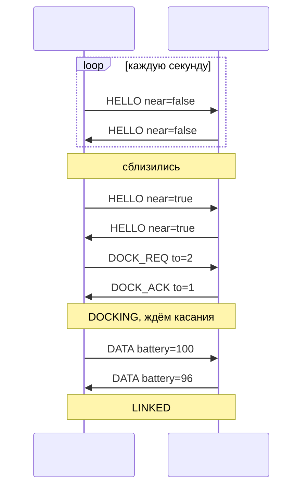

# Протокол связи модулей

← [на главную](../README.md)

Модули обмениваются короткими JSON-сообщениями. В симуляции все сообщения идут в один MQTT-топик `starys/swarm/demo` — общий «эфир» роя. Каждый модуль слышит всех и сам отбрасывает лишнее.

## Сообщения

| Сообщение | Кто отправляет | Когда | Пример |
|---|---|---|---|
| `HELLO` | любой модуль | в поиске, раз в секунду и сразу при изменении `near` | `{"type":"HELLO","id":1,"near":true,"role":"builder"}` |
| `DOCK_REQ` | модуль, заметивший соседа | свой датчик < 20 см и сосед тоже `near` | `{"type":"DOCK_REQ","from":1,"to":2}` |
| `DOCK_ACK` | сосед | согласен на стыковку | `{"type":"DOCK_ACK","from":2,"to":1}` |
| `DATA` | оба модуля | в связи, раз в секунду | `{"type":"DATA","id":2,"battery":87,"neighbor":1}` |
| `BYE` | любой модуль | при аварии или уходе | `{"type":"BYE","id":1}` |

### Поля

| Поле | Тип | Смысл |
|---|---|---|
| `type` | строка | тип сообщения |
| `id` / `from` | число | кто отправил (в `DOCK_*` — `from`, в остальных — `id`) |
| `to` | число | кому; нет поля или `0` — всем |
| `near` | bool | в `HELLO`: «мой датчик видит кого-то вплотную» |
| `role` | строка | в `HELLO`: роль модуля — `builder`, `power`, `scout`, `relay`, `coordinator`, `anchor` ([зачем](ideas.md#5-разные-модули-в-одном-рое)) |
| `battery` | 0–100 | в `DATA`: заряд отправителя, % |
| `neighbor` | число | в `DATA`: с кем состыкован отправитель |

## Правила приёма

1. Сообщение от самого себя (эхо MQTT) — отбросить.
2. Сообщение с `to`, не равным своему ID, — отбросить.
3. `HELLO` с `near:true` — запомнить отправителя как кандидата на стыковку на 3 с. `HELLO` с `near:false` от кандидата — забыть его.
4. `DOCK_REQ` принимается, только если модуль в поиске **и его собственный датчик тоже видит соседа вплотную**.
5. `DATA` и `BYE` учитываются, только если пришли от текущего соседа.

## Рукопожатие

### Встречный запрос

Если оба модуля одновременно увидели друг друга, оба пошлют `DOCK_REQ`. Каждый, получив `DOCK_REQ` от того, кого сам позвал, считает это согласием и отвечает `DOCK_ACK`. Конфликта нет, стыковка проходит с первого раза.

### Восстановление

| Событие | Реакция |
|---|---|
| Сосед не ответил `DOCK_ACK` за 5 с | назад в поиск |
| Договорились, но касания нет 15 с | `BYE` соседу, назад в поиск |
| В связи нет `DATA` от соседа 4 с | защёлка открыта, назад в поиск |
| Пришёл `BYE` от соседа | защёлка открыта, назад в поиск |
| Нажата «Авария» | `FAULT`: защёлка открыта, `BYE` всем, через 3 с поиск |

## Транспорт

| Этап | Транспорт | Как |
|---|---|---|
| Симуляция | MQTT через Wi-Fi Wokwi (`Wokwi-GUEST`), брокер `broker.hivemq.com:1883` | библиотека PubSubClient |
| Запасной вариант | Serial Monitor | модуль печатает `>> {json}`; строку JSON, вставленную в монитор, принимает как сообщение соседа |
| Настоящие модули | ESP-NOW (широковещательно, без роутера) | меняется только `main.cpp` |
| Опознание соседа «лицом к лицу» | ИК-маяк на каждой грани передаёт ID | заменяет флаг `near` точным знанием, кто перед датчиком |

> Публичный брокер видят все. Чтобы чужие демо не мешали, поменяйте суффикс топика в `MQTT_TOPIC` в [`main.cpp`](../firmware/src/main.cpp) на свой, например `starys/swarm/team42`.
