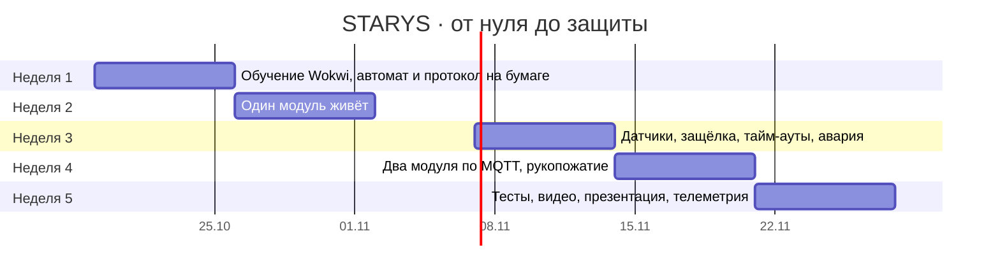

# План

← [на главную](../README.md)

## До защиты: 5 недель

Каждая неделя заканчивается тем, что можно показать.

| Неделя | Что делаем | Результат | Статус |
|---|---|---|---|
| 1 · Старт и обучение | новички проходят примеры Wokwi, опытные рисуют автомат и протокол | схема состояний согласована, репозиторий создан | ✅ автомат и протокол описаны, репозиторий готов |
| 2 · Один модуль живёт | автомат на одном ESP32, переходы кнопками, светодиод меняет цвет | видео, где модуль проходит все состояния | 🟡 код готов, нужна проверка в Wokwi и видео |
| 3 · Датчики и стыковка | HC-SR04, кнопка-контакт, сервопривод, тайм-ауты и ошибка | модуль сам решает, когда искать, а когда стыковаться | 🟡 код и автотесты готовы, нужна проверка в Wokwi |
| 4 · Два модуля разговаривают | MQTT между двумя вкладками, HELLO → DOCK_REQ → DOCK_ACK, обмен данными | два модуля стыкуются и восстанавливаются после разрыва | 🟡 код готов, проверить две симуляции одновременно |
| 5 · Полировка и защита | прогон тестов, видео, презентация, веб-панель телеметрии | готовое демо на 3 минуты | 🟡 веб-демо готово |

Открытые вопросы:

- проверить на первой неделе, можно ли в выбранном тарифе Wokwi держать две симуляции одновременно (запасной вариант — Serial-режим и веб-демо);
- сверить график с датой МКИ и сжать или растянуть недели под неё.

## После защиты

| Этап | Что | Как поймём, что готово |
|---|---|---|
| **v0.2 · Рой в симуляции** | 3+ модуля, у каждого 4 грани и 4 соседа; модуль знает свою позицию в решётке | 5 модулей в Wokwi или в веб-симуляторе собирают «крест» |
| **v0.3 · Планировщик** | центральный (потом распределённый) планировщик раздаёт цели: кто в какую ячейку встаёт; дальше — обучаемый ИИ-планировщик | рой собирает опору, мост и антенну из одного набора модулей |
| **v1.0 · Железо** | 2–4 настоящих модуля: корпус из [`hardware/`](../hardware), магниты, крюк, ESP-NOW, ИК-маяки | два модуля стыкуются на столе без человека |
| **v1.1 · Поле** | гусеничное шасси, солнечная панель, сон ночью | модуль сам подъезжает к соседу на песке |
| **v2 · Марсианские режимы** | ✅ `STORM`, `LOW_POWER`, `CHARGING` и расчёт маховика по g уже в прошивке; осталось `NIGHT` и профиль мира | рой переживает «бурю» и «ночь» в симуляции |
| **Мечта** | инфраструктура марсианской базы до прилёта людей | — |
